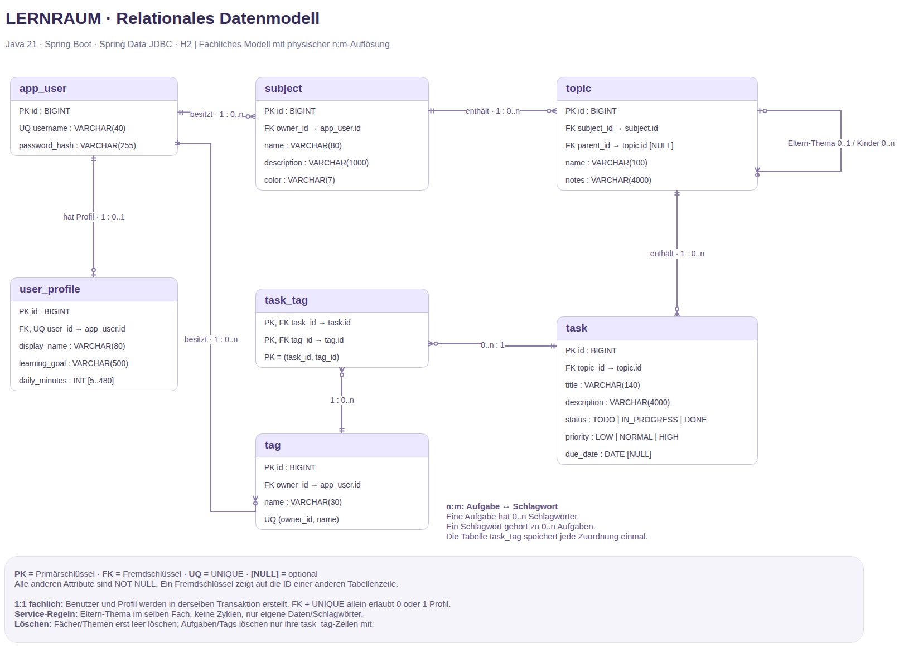

# ER-Modell – Vorgabe für euer Backend

Das Modell beschreibt die Datenbank, die ihr im Unterricht entwickelt. Die Tabellen sind im Ausgangsprojekt noch nicht angelegt. Erstellt daraus später eine eigene `backend/src/main/resources/schema.sql` und die passenden Java-Modelle.

- [Bearbeitbare draw.io-Datei](lernraum-er.drawio) – in draw.io/diagrams.net über „Datei → Öffnen von → Gerät“ öffnen.
- [PNG-Vorschau](lernraum-er.png) – ohne Diagrammprogramm ansehen.
- [REST-API-Vertrag](API.md) – die vom Frontend erwarteten Daten und Endpunkte.

## Tabellen und Beziehungen

| Tabelle | Zweck | Wichtige Beziehungen |
| --- | --- | --- |
| `app_user` | Benutzername und Passwort-Hash | Ein Benutzer besitzt sein Profil, seine Fächer und seine Schlagwörter. |
| `user_profile` | Anzeigename, Lernziel, tägliches Minutenziel | `user_id` verweist eindeutig auf den Benutzer: fachlich **1:1**. |
| `subject` | Persönliches Fach mit Beschreibung und Farbe | `owner_id` verweist auf den Besitzer: **1:n**. |
| `topic` | Thema mit Notizen und optionalem Eltern-Thema | `subject_id` verweist auf das Fach: **1:n**. `parent_id` bildet Unterthemen über einen Selbstverweis ab. |
| `task` | Lernaufgabe/Todo mit Status, Priorität und optionalem Termin | `topic_id` verweist auf das Thema: **1:n**. |
| `tag` | Persönliches Schlagwort | `owner_id` verweist auf den Besitzer. Der Name ist innerhalb eines Benutzers eindeutig. |
| `task_tag` | Verknüpfung von Aufgabe und Schlagwort | Zwei Fremdschlüssel bilden die **n:m**-Beziehung; beide zusammen sind der Primärschlüssel. |

Alle Attribute, Datentypen, Schlüssel und Kardinalitäten stehen im Diagramm. `PK` bedeutet Primärschlüssel, `FK` Fremdschlüssel und `UQ` eindeutig. `[NULL]` kennzeichnet optionale Werte; die übrigen Spalten sind verpflichtend.

## Fachliche Regeln

- Beim Registrieren werden ein Benutzer und genau ein Profil gemeinsam angelegt. Ein eindeutiger Fremdschlüssel allein erzwingt aus Sicht eines Benutzers nur null oder ein Profil; die Anwendung muss das gemeinsame Anlegen gewährleisten.
- Jedes Fach hat einen Besitzer. Jedes Thema gehört zu genau einem Fach, jede Aufgabe zu genau einem Thema.
- Ein Hauptthema hat keinen Elternteil. Unterthemen müssen im selben Fach liegen; die Hierarchie darf keinen Kreis bilden.
- Eine Aufgabe kann mehrere Schlagwörter haben; dasselbe Schlagwort kann mehreren Aufgaben zugeordnet sein. Eine Zuordnung darf nur einmal vorkommen.
- Benutzer dürfen ausschließlich ihre eigenen Daten lesen und ändern. Das gilt auch für alle miteinander verknüpften Daten.
- Aufgaben enthalten keine zusätzliche Fach-ID in der Datenbank: Das Fach ergibt sich aus ihrem Thema. In REST-Antworten wird `subjectId` für das Frontend ergänzt.
- Ein Fach darf erst gelöscht werden, wenn es keine Themen mehr besitzt. Ein Thema darf erst gelöscht werden, wenn es keine Unterthemen und keine Aufgaben mehr besitzt.
- Das Löschen einer Aufgabe oder eines Schlagworts entfernt die jeweiligen Zuordnungen in `task_tag`. Die Datensätze auf der anderen Seite bleiben erhalten.
- Statuswerte: `TODO`, `IN_PROGRESS`, `DONE`. Prioritäten: `LOW`, `NORMAL`, `HIGH`.
